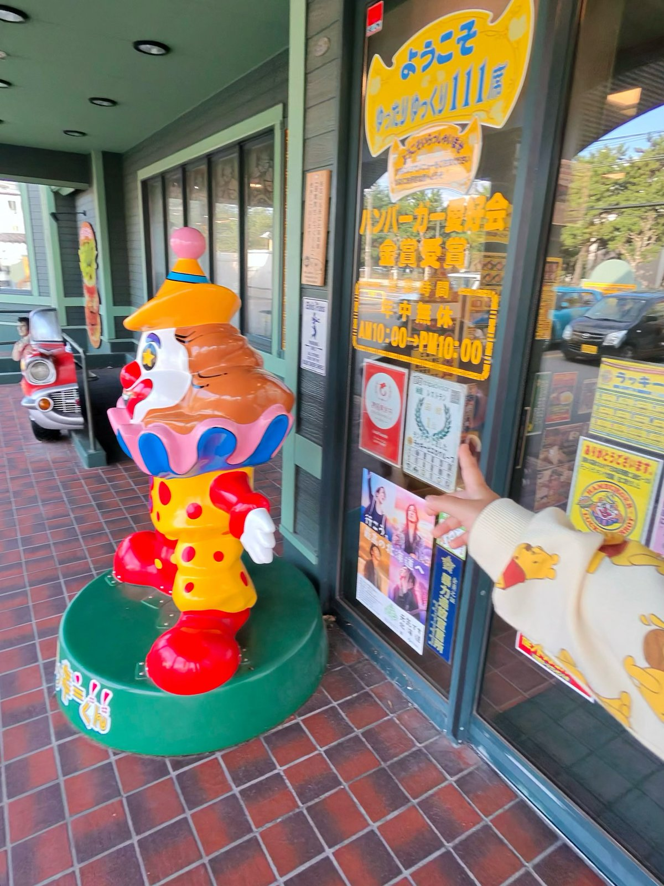

日曜日、家族でラッキーピエロに行ってきた。

函館のあたりにしかない、ご当地ハンバーガーの店だ。道南の人間にとって、ラッピは「ハンバーガー屋」ではない。もはや信仰に近い。

予定では、八雲から森町あたりまで行って、ラッピを食べて帰ってくるはずだった。

はずだった。

車の中で誰かが「せっかくだから函館まで行く？」と言った。

この「せっかくだから」は危ない。北海道の「せっかくだから」は、だいたい100キロ単位で話が大きくなる。

気づいたら函館にいた。

しかも日帰りである。

店の前では、ピエロが出迎えてくれた。

ニコニコしているけど、目が星になっている。完全に何かをキメている顔だ。こっちはまだ運転の疲れで目が死んでいるので、テンションの差がすごい。

その奥には、赤いクラシックカーが停まっていた。運転席には人が乗っている。動かない。たぶん何十年も、ここで誰かを待っている。

入口のガラスには「ハンバーガー愛好会 金賞受賞」の文字。その下に「年中無休 AM10:00→PM10:00」。

年中無休。このピエロも、あのクラシックカーの人も、休みなしで働いている。窓際で一日中ぼーっとしている自分が、少し恥ずかしくなった。

家族はというと、僕がピエロの顔をしげしげと観察している間に、もう扉を押していた。迷いがない。腹が減っている人間の動きは速い。

ハンバーガーはうまかった。

片道何時間もかけて来て、うまくなかったら泣くところだった。うまかったので、泣かずに済んだ。

問題は帰りだ。

満腹になった家族は、車に乗った瞬間に全員寝た。起きているのは運転している僕だけ。暗くなった道を、ひとりで黙々と走る。カーナビの声だけが話し相手だった。カーナビは「この先、道なりです」しか言わない。知ってる。

家に着いたのは夜だった。

車から降りようとしたら、おしりが座席の形のまま固まっていた。腰はもう、自分のものじゃない感じがする。立ち上がるのに、3回くらい「よいしょ」が必要だった。

**一言感想:** ラッピは、函館まで行く価値がある。ただし、おしりと腰の分の代償は払うことになる。

全然関係ないけど、次の日の朝、まだおしりが痛い。地獄の日帰り旅は、終わってからが本番だ。
