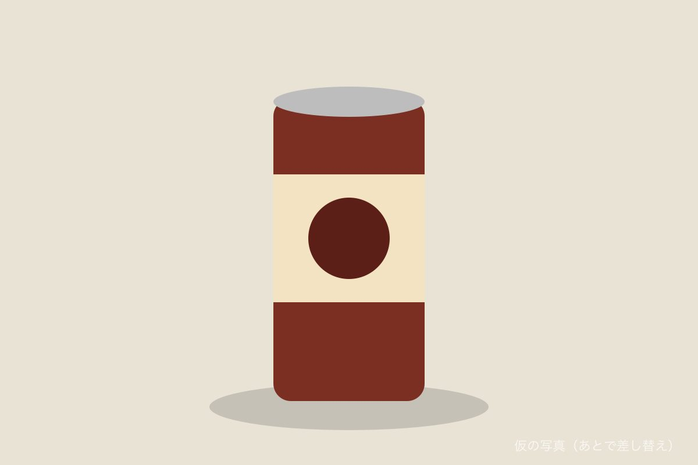

会社帰り、いつもの自販機を見たら、左上の定位置におしるこが戻っていた。

まだ9月だ。

横を半袖の高校生が通り過ぎていく。自販機だけが一足先に冬を迎えに行っている。気が早いにも程がある。たぶんこの自販機、正月の時点で節分の準備をしている。

せっかくなので買った。

熱い。持てない。左手と右手で交互に持ち替えていたら、はたから見ると缶とお手玉をしているおっさんになっていた。

通りがかったおばあちゃんに二度見された。たぶん大道芸人だと思われた。投げ銭はもらえなかった。

飲み終わったあと、缶の底に小豆が4粒残った。

去年も4粒だった。

缶を逆さにして底をトントン叩くと1粒ずつ落ちてくるんだけど、最後の1粒だけは絶対に出てこない。あれは缶の守り神なんだと思う。そっとしておいた。

**一言感想:** 季節を先取りしすぎる自販機は、ちょっと頼もしい。そして最後の1粒は永遠に缶のもの。

全然関係ないけど、自販機の「あったか〜い」の「〜」を考えた人は、日本の冬を5度くらい暖かくしたと思う。
